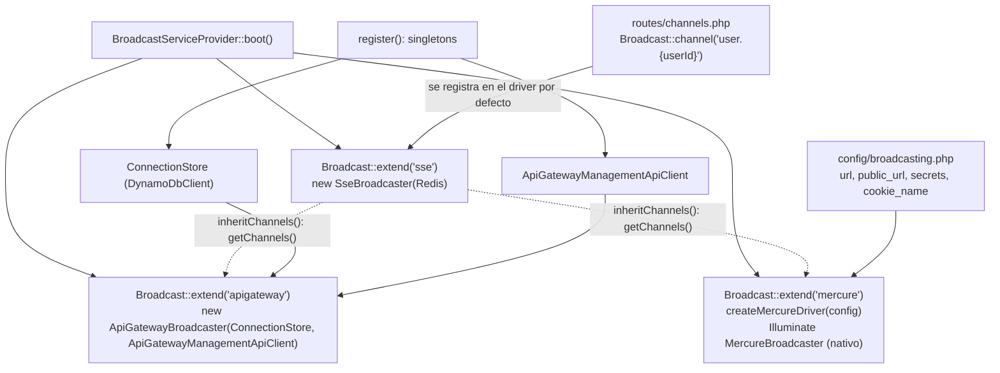
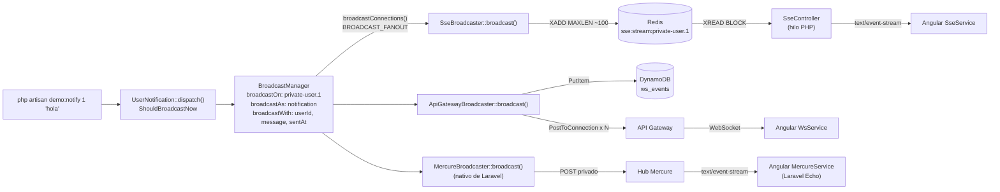

# Diagramas de los drivers de broadcasting

Este repo evalúa tres drivers de broadcasting de Laravel (dos propios y el
`mercure` nativo del framework) para decidir
cuál adopta la empresa; la comparación y la recomendación están en
[Evaluación y decisión](../README.md#evaluación-y-decisión). Los tres corren
**a la vez**: un mismo `UserNotification` sale por todos los drivers listados en
`BROADCAST_FANOUT` (por defecto `sse,apigateway,mercure`), así se comparan sobre
el mismo evento.

| Driver | Quién sostiene la conexión | Estado / historial | Diagramas |
|---|---|---|---|
| `sse` | Un hilo PHP por cliente (FrankenPHP, `num_threads 64`) | Redis Streams | [sse.md](sse.md) |
| `apigateway` | AWS API Gateway WebSocket (`gateway-local` en docker) | DynamoDB (3 tablas con TTL) | [apigateway.md](apigateway.md) |
| `mercure` | Hub Mercure en Go, dentro de FrankenPHP (driver nativo + Echo) | Bolt (archivo local del hub) | [mercure.md](mercure.md) |

Cada documento tiene un **diagrama de flujo** (decisiones, errores y
reconexión) y un **diagrama de secuencia** end-to-end (autenticación →
suscripción → publicación → entrega → reconexión).

## Registro de los drivers

`BroadcastServiceProvider::boot()` registra los tres drivers con
`Broadcast::extend()`. `mercure` es el driver nativo de Laravel: el `extend()`
solo llama al creador del framework (`createMercureDriver()`, que arma el `Hub`
desde `config/broadcasting.php`). Los callbacks de `routes/channels.php` se
registran solo en el driver por defecto; `apigateway` y `mercure` los copian,
así la autorización tiene una única fuente de verdad.

## Fan-out común

`UserNotification` implementa `ShouldBroadcastNow` (sin cola) y
`broadcastConnections()` devuelve `config('broadcasting.fanout')`. Laravel arma
el payload una sola vez, por eso `sentAt` es idéntico en los tres transportes y
las latencias se pueden comparar.

