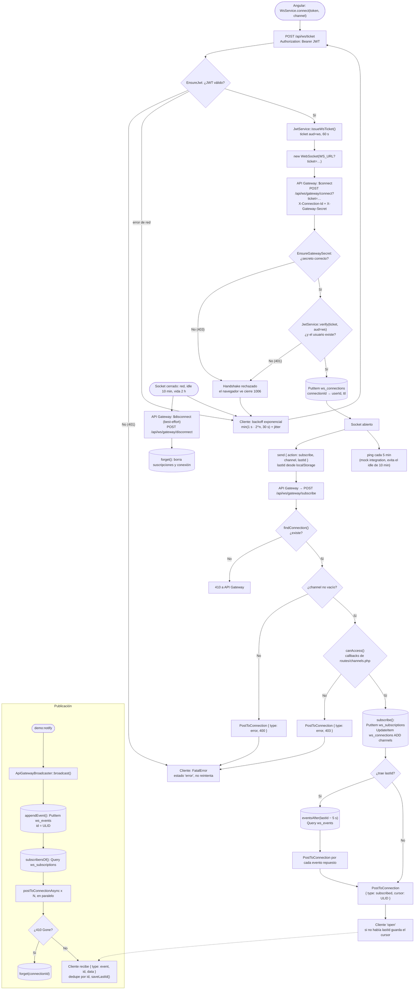
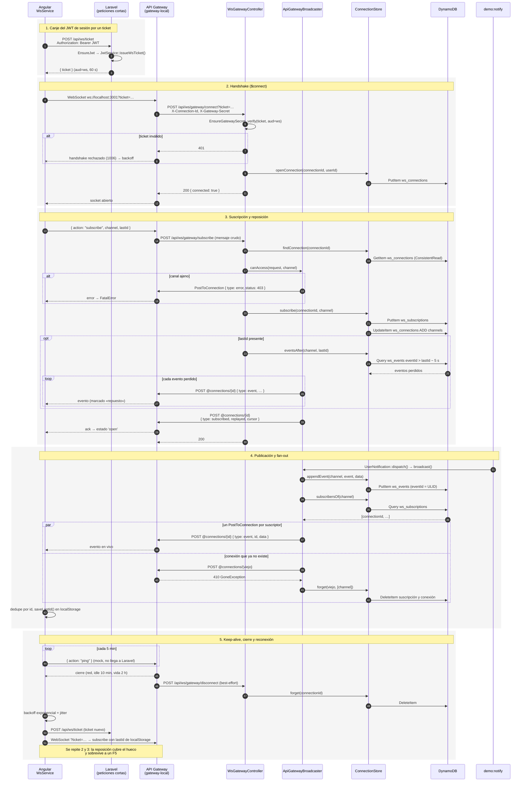

# Driver `apigateway`: API Gateway WebSocket + DynamoDB

Los WebSockets los sostiene **API Gateway** (en local, el emulador
`gateway-local`). Laravel solo atiende POST cortos: API Gateway le reenvía
`$connect`, `subscribe` y `$disconnect`, y Laravel le escribe a cada cliente
con `PostToConnection`. El estado (conexiones, suscripciones e historial)
vive en DynamoDB.

[← Volver al índice](README.md)

## Diagrama de flujo

## Diagrama de secuencia

## Piezas

| Qué | Dónde |
|---|---|
| Driver | [ApiGatewayBroadcaster.php](../api/app/Broadcasting/ApiGatewayBroadcaster.php) |
| Estado en DynamoDB | [ConnectionStore.php](../api/app/Broadcasting/ApiGateway/ConnectionStore.php) |
| Rutas que llama API Gateway | [WsGatewayController.php](../api/app/Http/Controllers/WsGatewayController.php) |
| Ticket del handshake | [WsTicketController.php](../api/app/Http/Controllers/WsTicketController.php), [JwtService.php](../api/app/Services/JwtService.php) |
| Protección de `/api/ws/gateway/*` | [EnsureGatewaySecret.php](../api/app/Http/Middleware/EnsureGatewaySecret.php) |
| Autorización compartida | [AuthorizesChannelAccess.php](../api/app/Broadcasting/AuthorizesChannelAccess.php), [channels.php](../api/routes/channels.php) |
| Emulador local | [gateway-local/server.js](../gateway-local/server.js) |
| Infraestructura AWS | [infra/template.yaml](../infra/template.yaml) |
| Cliente | [ws.service.ts](../web/src/app/ws.service.ts) |
