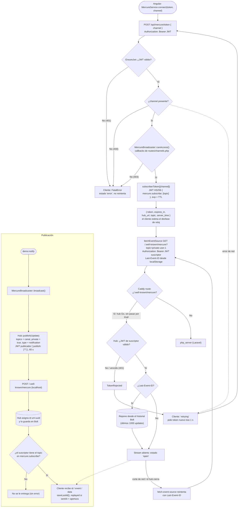
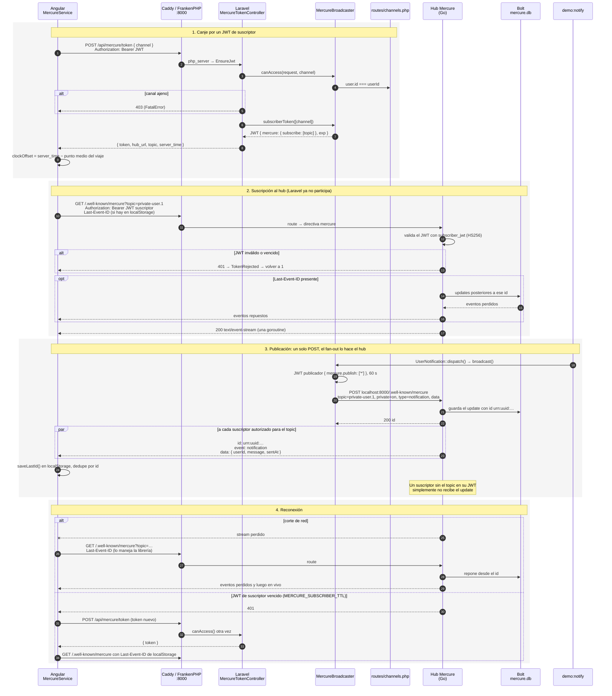

# Driver `mercure`: hub Mercure dentro de FrankenPHP

El navegador sigue recibiendo SSE, pero la conexión la sostiene el **hub
Mercure** (Go, una goroutine por suscriptor) que corre en el mismo FrankenPHP.
Laravel solo hace dos cosas: firma el JWT de suscriptor después de pasar por
`routes/channels.php`, y publica un POST privado al hub por evento.

[← Volver al índice](README.md)

## Diagrama de flujo

## Diagrama de secuencia

## Piezas

| Qué | Dónde |
|---|---|
| Driver | [MercureBroadcaster.php](../api/app/Broadcasting/MercureBroadcaster.php) |
| Canje del JWT de suscriptor | [MercureTokenController.php](../api/app/Http/Controllers/MercureTokenController.php) |
| Hub y JWT publicador | [BroadcastServiceProvider.php](../api/app/Providers/BroadcastServiceProvider.php) |
| Autorización compartida | [AuthorizesChannelAccess.php](../api/app/Broadcasting/AuthorizesChannelAccess.php), [channels.php](../api/routes/channels.php) |
| Hub (directiva `mercure`, Bolt, claves) | [Caddyfile](../api/docker/Caddyfile) |
| Configuración | [broadcasting.php](../api/config/broadcasting.php) |
| Cliente | [mercure.service.ts](../web/src/app/mercure.service.ts) |
