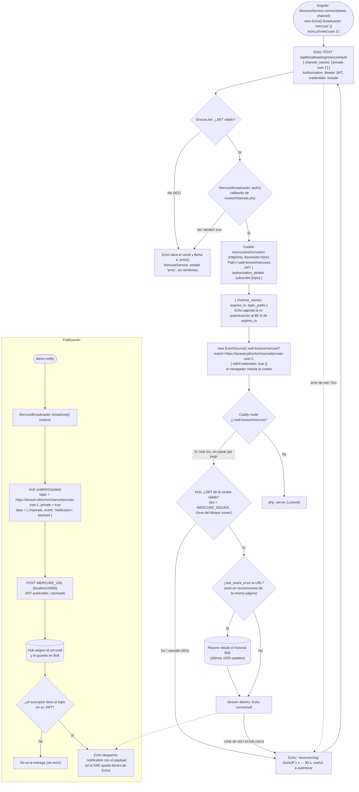
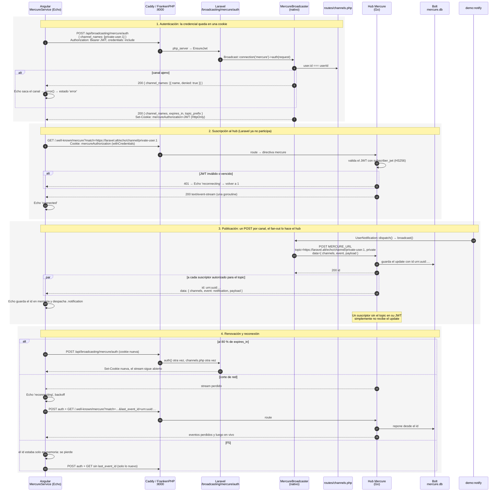

# Driver `mercure`: driver nativo de Laravel + Echo, hub dentro de FrankenPHP

El navegador sigue recibiendo SSE, pero la conexión la sostiene el **hub
Mercure** (Go, una goroutine por suscriptor) que corre en el mismo FrankenPHP.
No hay código propio de transporte: el broadcaster es
`Illuminate\Broadcasting\Broadcasters\MercureBroadcaster` y el cliente es el
conector `mercure` de Laravel Echo. Laravel solo hace dos cosas: deja el JWT de
suscriptor en una cookie después de pasar por `routes/channels.php`, y publica
un POST privado al hub por canal y por evento.

[← Volver al índice](README.md)

## Diagrama de flujo

## Diagrama de secuencia

## Diferencias con el driver propio anterior

Hasta este cambio el driver era propio (`App\Broadcasting\MercureBroadcaster`,
`MercureTokenController` y `@microsoft/fetch-event-source`). Pasar al nativo:

| | Driver propio (antes) | Nativo + Echo (ahora) |
|---|---|---|
| Código propio | broadcaster, controller del token, cliente | solo configuración, una ruta y el adaptador a `Transport` |
| Credencial de suscriptor | JWT en el JSON, `Authorization: Bearer` | cookie HttpOnly |
| Requisitos de despliegue | ninguno (el hub puede estar en cualquier dominio) | CORS con credenciales, front y hub en el mismo sitio, cookie sin prefijo `__Secure-` en HTTP |
| Reposición tras F5 | sí (`Last-Event-ID` en `localStorage`) | no (Echo guarda el id en memoria) |
| Id del evento en el cliente | sí | no (queda dentro de Echo) |
| `replayed` | reloj del servidor estimado con `server_time` | reloj del navegador |
| Renovación | al recibir 401 del hub | proactiva, al 80 % de `expires_in` |
| Protocolo Mercure | legacy (`topic`, claim `mercure`) | 1.0 (`match`, `last_event_id`, `authorization_details`) |
| Hub | FrankenPHP 1.12 (Mercure 0.24), `publisher_jwt` / `subscriber_jwt` | FrankenPHP 1.13 (Mercure 1.0), bloque `issuer` + `MERCURE_ISSUER` |
| Extra que se gana | — | presence channels, whispers, canales cifrados, varios canales en un `EventSource` |

## Piezas

| Qué | Dónde |
|---|---|
| Driver (nativo) | `Illuminate\Broadcasting\Broadcasters\MercureBroadcaster` (en `api/vendor/laravel/framework`) |
| Registro con los canales heredados | [BroadcastServiceProvider.php](../api/app/Providers/BroadcastServiceProvider.php) |
| Endpoint de auth de Echo | [api.php](../api/routes/api.php) → `/broadcasting/mercure/auth` |
| Autorización | [channels.php](../api/routes/channels.php) |
| Hub (directiva `mercure`, Bolt, `issuer`, cookie) | [Caddyfile](../api/docker/Caddyfile), versión en [Dockerfile](../api/docker/Dockerfile) |
| Configuración | [broadcasting.php](../api/config/broadcasting.php), [cors.php](../api/config/cors.php) |
| Cliente (Echo) | [mercure.service.ts](../web/src/app/mercure.service.ts) |
