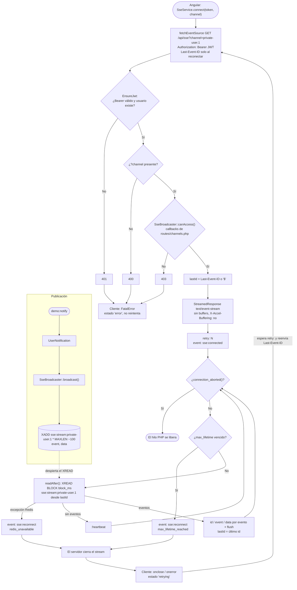
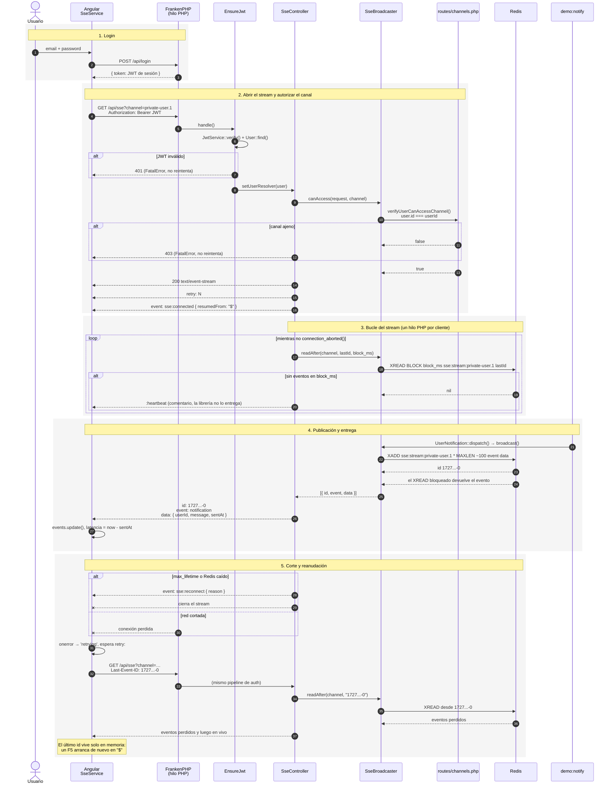

# Driver `sse`: Server-Sent Events + Redis Streams

Laravel escribe cada evento en un Redis Stream por canal (`XADD`). El navegador
abre un `GET /api/sse` que **no termina**: un hilo PHP queda bloqueado en
`XREAD BLOCK` y escribe cada evento como SSE. Reanudar es `Last-Event-ID`
nativo, porque el id de `XADD` se usa tal cual como `id:` de SSE.

[← Volver al índice](README.md)

## Diagrama de flujo

## Diagrama de secuencia

## Piezas

| Qué | Dónde |
|---|---|
| Driver | [SseBroadcaster.php](../api/app/Broadcasting/SseBroadcaster.php) |
| Endpoint del stream | [SseController.php](../api/app/Http/Controllers/SseController.php) |
| Middleware JWT | [EnsureJwt.php](../api/app/Http/Middleware/EnsureJwt.php) |
| Autorización de canales | [channels.php](../api/routes/channels.php) |
| Configuración | [broadcasting.php](../api/config/broadcasting.php), [sse.php](../api/config/sse.php) |
| Servidor (hilos, sin `encode`) | [Caddyfile](../api/docker/Caddyfile) |
| Cliente | [sse.service.ts](../web/src/app/sse.service.ts) |
